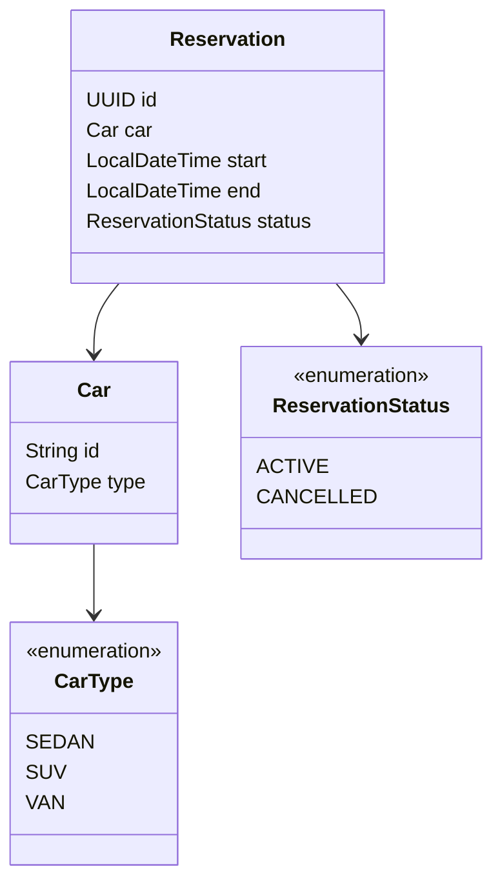

# Car Rental System – Technical Design

**Status:** Draft (skeleton in place, logic not implemented)
**Last updated:** 2026-11-08

## 1. Overview

A simulated car rental system. Customers can see which cars are free for a period, reserve a
car of a given type for a start date/time and a number of days, change a reservation, and
cancel it. The number of cars of each type is limited.

## 2. Goals and non-goals

**Goals**
- Model the rental domain with clear object-oriented layers.
- Expose the main actions as a REST API.
- Keep all data access behind a repository layer.

**Non-goals (for now)**
- Payments, customer accounts and authentication.
- Multiple rental locations or time zones.
- A specific database. The repositories define the data access, not the storage technology.

## 3. Architecture

The system is split into four layers. Each layer only talks to the one below it.


| Layer | Responsibility |
|---|---|
| **Controller** | Receives HTTP requests, validates input, returns responses. No business rules. Each controller has two `@ExceptionHandler`s: bad input returns 400, and any other unhandled error returns 500 with a short message. |
| **Service** | Business logic. `RentalService` handles the booking rules and calls the repositories for data. |
| **Repository** | The only place that reads or writes data. |
| **Model** | Plain data types shared by all layers. |

## 4. API

| # | Method | Path | Purpose |
|---|---|---|---|
| 4.1 | GET | `/availability` | Free cars per type for a period |
| 4.2 | POST | `/reservations` | Reserve a car of a type |
| 4.3 | GET | `/reservations/{id}` | View a reservation |
| 4.4 | PATCH | `/reservations/{id}` | Change type, start and/or days |
| 4.5 | DELETE | `/reservations/{id}` | Cancel a reservation |

Dates and times use ISO-8601 format, e.g. `2030-12-01T10:00:00`. The error codes below are
the intended ones.

### 4.1 Check availability – `GET /availability`

Shows how many cars of each type are free for the whole period. Used to show options
before booking. It is a snapshot only: it does not hold a car.

**Handled by:** `AvailabilityController.availability` → `RentalService.availability`

**Query parameters**

| Name | Type | Required | Description |
|---|---|---|---|
| `start` | date-time | Yes | Start of the rental |
| `days` | integer | Yes | Number of days, at least 1 |
| `carType` | `SEDAN` / `SUV` / `VAN` | No | Only show this type |

**Example**

```http
GET /availability?start=2030-12-01T10:00:00&days=3
```

```http
HTTP/1.1 200 OK

{
  "start": "2030-12-01T10:00:00",
  "end": "2030-12-04T10:00:00",
  "available": [
    { "carType": "SEDAN", "count": 3 },
    { "carType": "SUV", "count": 1 },
    { "carType": "VAN", "count": 0 }
  ]
}
```

**Responses**

| Status | When |
|---|---|
| 200 OK | Availability returned |
| 400 Bad Request | Missing or invalid `start`/`days`, unknown `carType` |

### 4.2 Create a reservation – `POST /reservations`

Reserves one car of the requested type. The system picks a specific car that is free for
the whole period.

**Handled by:** `ReservationController.create` → `RentalService.reserve`

**Request body** (`ReservationRequest`)

| Field | Type | Required | Description |
|---|---|---|---|
| `carType` | `SEDAN` / `SUV` / `VAN` | Yes | Type of car wanted |
| `start` | date-time | Yes | Start of the rental |
| `days` | integer | Yes | Number of days, at least 1 |

**Example**

```http
POST /reservations
Content-Type: application/json

{ "carType": "SUV", "start": "2030-12-01T10:00:00", "days": 3 }
```

```http
HTTP/1.1 201 Created
Location: /reservations/3f2a9c1e-5b7d-4e2a-9f4c-1a2b3c4d5e6f

{
  "id": "3f2a9c1e-5b7d-4e2a-9f4c-1a2b3c4d5e6f",
  "carId": "SUV-1",
  "carType": "SUV",
  "start": "2030-12-01T10:00:00",
  "end": "2030-12-04T10:00:00",
  "days": 3,
  "status": "ACTIVE"
}
```

**Responses**

| Status | When |
|---|---|
| 201 Created | Reservation made; `Location` header points to it |
| 400 Bad Request | Missing or invalid fields |
| 409 Conflict | No car of that type is free for the period |

### 4.3 Get a reservation – `GET /reservations/{id}`

Returns one reservation, including cancelled ones.

**Handled by:** `ReservationController.get` → `RentalService.getReservation`

**Path parameters**

| Name | Type | Description |
|---|---|---|
| `id` | UUID | Reservation id |

**Example**

```http
GET /reservations/3f2a9c1e-5b7d-4e2a-9f4c-1a2b3c4d5e6f
```

```http
HTTP/1.1 200 OK

{
  "id": "3f2a9c1e-5b7d-4e2a-9f4c-1a2b3c4d5e6f",
  "carId": "SUV-1",
  "carType": "SUV",
  "start": "2030-12-01T10:00:00",
  "end": "2030-12-04T10:00:00",
  "days": 3,
  "status": "ACTIVE"
}
```

**Responses**

| Status | When |
|---|---|
| 200 OK | Reservation returned |
| 404 Not Found | No reservation with that id |

### 4.4 Modify a reservation – `PATCH /reservations/{id}`

Changes the car type, start and/or number of days. Only the fields sent are changed. If the
change can't be made, the original reservation stays as it was.

**Handled by:** `ReservationController.update` → `RentalService.modify`

**Path parameters**

| Name | Type | Description |
|---|---|---|
| `id` | UUID | Reservation id |

**Request body** (`ReservationUpdateRequest`)

| Field | Type | Required | Description |
|---|---|---|---|
| `carType` | `SEDAN` / `SUV` / `VAN` | No | New car type |
| `start` | date-time | No | New start |
| `days` | integer | No | New number of days, at least 1 |

**Example** – extend to 5 days

```http
PATCH /reservations/3f2a9c1e-5b7d-4e2a-9f4c-1a2b3c4d5e6f
Content-Type: application/json

{ "days": 5 }
```

```http
HTTP/1.1 200 OK

{
  "id": "3f2a9c1e-5b7d-4e2a-9f4c-1a2b3c4d5e6f",
  "carId": "SUV-1",
  "carType": "SUV",
  "start": "2030-12-01T10:00:00",
  "end": "2030-12-06T10:00:00",
  "days": 5,
  "status": "ACTIVE"
}
```

**Responses**

| Status | When |
|---|---|
| 200 OK | Reservation updated |
| 400 Bad Request | Invalid fields |
| 404 Not Found | No reservation with that id |
| 409 Conflict | No car free for the new period, or the reservation is cancelled |

### 4.5 Cancel a reservation – `DELETE /reservations/{id}`

Cancels a reservation and frees its car. The reservation is kept with status `CANCELLED`
rather than deleted. Cancelling twice has no extra effect.

**Handled by:** `ReservationController.cancel` → `RentalService.cancel`

**Path parameters**

| Name | Type | Description |
|---|---|---|
| `id` | UUID | Reservation id |

**Example**

```http
DELETE /reservations/3f2a9c1e-5b7d-4e2a-9f4c-1a2b3c4d5e6f
```

```http
HTTP/1.1 204 No Content
```

**Responses**

| Status | When |
|---|---|
| 204 No Content | Reservation cancelled (or was already cancelled) |
| 404 Not Found | No reservation with that id |

## 5. Components

### 5.1 Controllers

| Controller | Purpose |
|---|---|
| `ReservationController` | Create, view, change and cancel reservations |
| `AvailabilityController` | Show how many cars of each type are free for a period |

### 5.2 Services

| Service | Methods |
|---|---|
| `RentalService` | `reserve`, `getReservation`, `modify`, `cancel`, `availability` |

### 5.3 Repositories

| Repository | Methods |
|---|---|
| `CarRepository` | `findAll`, `findById`, `findByType`, `save`, `deleteById` |
| `ReservationRepository` | `findAll`, `findById`, `findActiveByCarId`, `save`, `deleteById` |

## 6. Data model



- A **Car** is one physical car, e.g. `SUV-2`, of a given type.
- A **Reservation** books one car from `start` to `end`. Cancelling changes its status
  rather than deleting it.

## 7. Main flow: reserving a car

1. Client sends `POST /reservations` with car type, start and number of days.
2. `ReservationController` validates the request and calls `RentalService.reserve`.
3. `RentalService` gets the cars of that type from `CarRepository`, and their active
   reservations from `ReservationRepository`.
4. It picks a car with no overlapping reservation. If none is free, the request is rejected.
5. It saves the new reservation through `ReservationRepository` and returns it.

### Repository calls per service method

| `RentalService` method | Repository calls |
|---|---|
| `reserve` | `CarRepository.findByType`, `ReservationRepository.findActiveByCarId`, `ReservationRepository.save` |
| `getReservation` | `ReservationRepository.findById` |
| `modify` | `ReservationRepository.findById`, `CarRepository.findByType`, `ReservationRepository.findActiveByCarId`, `ReservationRepository.save` |
| `cancel` | `ReservationRepository.findById`, `ReservationRepository.save` |
| `availability` | `CarRepository.findByType`, `ReservationRepository.findActiveByCarId` |
